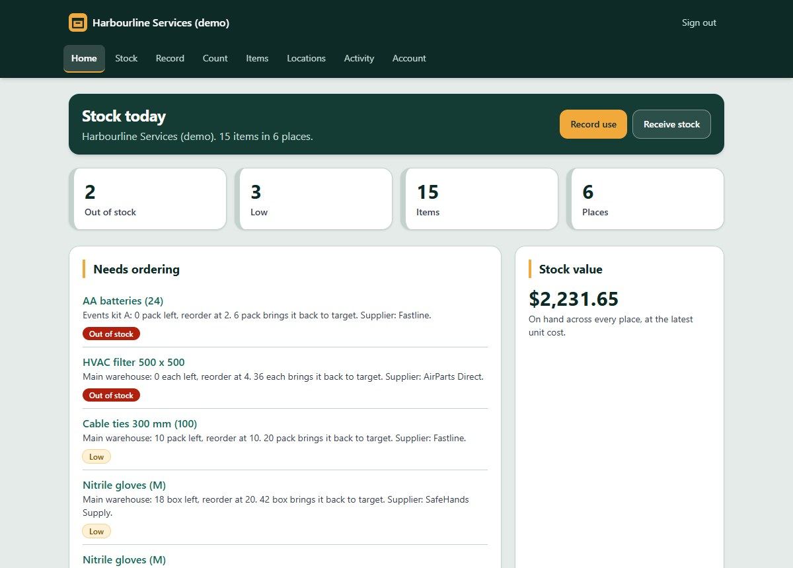
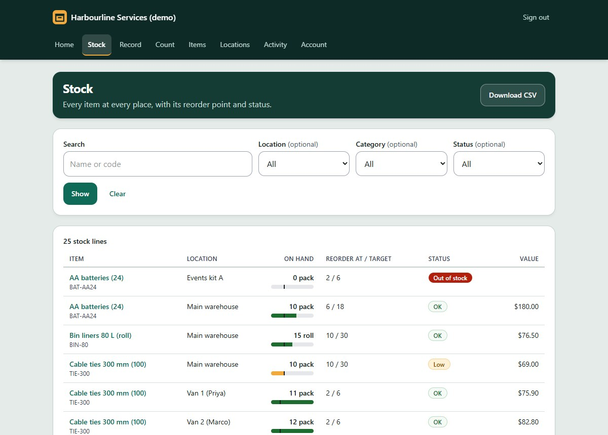
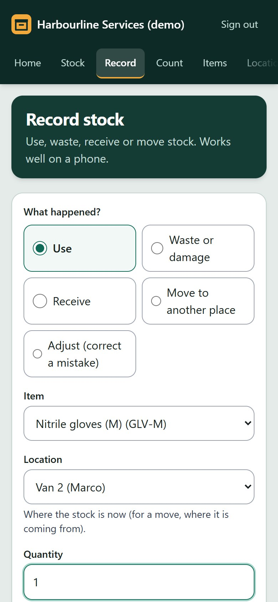

# Binwright Lite

Free, open-source stock tracking for small businesses that keep stock in vans, storerooms, shelves and kits, running
in your own Cloudflare account.

[Live demo](https://binwright-demo.redcenterstudio.com) · [Get Pro](https://redcenterstudio.com/binwright/) ·
[Docs](SETUP.md)

The live demo runs Binwright Pro, so it also shows the Pro features listed below. Sign in with one of the demo
buttons; the data resets every night.

[](https://deploy.workers.cloudflare.com/?url=https://github.com/Red-Center-Studio/binwright-lite)



| Stock at every place                                                   | Recording use on a phone                                                           |
| ---------------------------------------------------------------------- | ---------------------------------------------------------------------------------- |
|  |  |

## What Lite does

- **Record from a phone.** Use, waste, receive, move between places, or adjust (managers, with a reason). The form
  only shows the fields that matter for what happened.
- **Every place, nested.** Vans, rooms, shelves inside rooms, kits. Call them what you like: Location, Van, Room, Kit.
- **Reorder points.** Set "reorder at" and "top up to" for each item at each place. The home page lists everything
  at or below its reorder point, with how much brings it back to target and who supplies it.
- **Counts.** Count a place with the expected numbers shown or hidden (blind count). Each count corrects the stock and
  is saved in the history.
- **An honest ledger.** Every change is saved with who, what, where and when, and never edited. Stock can never go
  below zero, even when two people take the last one at the same moment. Filter by item, place, person, job
  reference or date.
- **CSV export** of stock and of the full activity history, for your accountant or a backup.
- **Stock value** at the latest unit cost, shown to managers and admins only.
- **Your region.** Currency, metric or US units, date format and time zone are set per install.
- **Roles.** Staff, Manager and Admin, checked on the server for every action. New sign-ups wait for an admin to
  approve them; the first account becomes the Admin.
- **Accessible and fast.** Server-rendered pages, one small script, every page works without JavaScript. WCAG 2.2 AA
  checked with axe at desktop and phone width.
- **Free to run.** One Cloudflare Worker and one D1 database. Cloudflare's free plan covers a typical small business.

## What Pro adds

Binwright Pro is $99 USD once for one business, with no monthly fee and no limit on users, items or places. See
[redcenterstudio.com/binwright](https://redcenterstudio.com/binwright/).

| Feature                                                                     | Lite         | Pro          |
| --------------------------------------------------------------------------- | ------------ | ------------ |
| Price                                                                       | Free, MIT    | $99 USD once |
| Items, nested places, reorder points and targets                            | Yes          | Yes          |
| Record use, waste, receive, move, count and adjust from a phone             | Yes          | Yes          |
| Ledger that is never edited, with CSV export                                | Yes          | Yes          |
| Low and out-of-stock list                                                   | Yes          | Yes          |
| Run-out forecasts per item per place, from recent usage                     | No           | Yes          |
| Reorder list by supplier, rounded up to whole packs, with an order sheet    | No           | Yes          |
| Daily restock email to managers                                             | No           | Yes          |
| Suggestions: move instead of buying, usage jumps, dead stock, what to count | No           | Yes          |
| Reorder points worked out from real usage                                   | No           | Yes          |
| Batches and expiry dates, earliest expiry first                             | No           | Yes          |
| Multi-line deliveries with a photo of the docket                            | No           | Yes          |
| QR labels for places and items, barcode scanning                            | No           | Yes          |
| CSV import of items with opening stock                                      | No           | Yes          |
| Where your data lives                                                       | Your account | Your account |

## Deploy in 5 minutes

**Fastest:** click **Deploy to Cloudflare** above. Cloudflare copies this repository into your GitHub account,
creates the database, asks for one secret (`AUTH_SECRET`: paste a long random string of at least 32 characters) and
deploys it. Open the address it gives you and create the first account: it becomes the Admin.

**Manual steps** (Node.js 22.18 or newer):

```bash
npm install
npx wrangler login
npx wrangler secret put AUTH_SECRET
npm run build:css && npx wrangler deploy   # first time only: creates the database
npm run deploy                             # applies migrations, then deploys
```

Then open the address it prints and create the first account (it becomes the Admin).

[SETUP.md](SETUP.md) walks through every step for people who have never deployed code, including your own web
address and email for password resets. [CUSTOMISING.md](CUSTOMISING.md) covers roles, captions, colours and adding
fields.

To try it on your computer first:

```bash
npm install
cp .dev.vars.example .dev.vars
npm run dev          # http://localhost:8787
npm run seed:local   # optional: sample data (wipes the local database)
npm run check        # type check, lint and unit tests
npm run test:e2e     # browser tests with accessibility checks (uses Microsoft Edge or Chrome)
```

## Need it set up for you?

The Turnkey Setup installs Binwright in your own Cloudflare account, with your business name, currency and units,
places, items and first team members loaded. $499 USD, paid once, usually done in 1 to 5 days.
[Book the Turnkey Setup](https://redcenterstudio.com/start/?package=Turnkey%20Setup%20Sprint&for=binwright), or read
more on the [Binwright page](https://redcenterstudio.com/binwright/).

## Licence: MIT

Free to use, change and share, for any business. See [LICENSE](LICENSE).

Built by Red Center Studio, [redcenterstudio.com](https://redcenterstudio.com)
